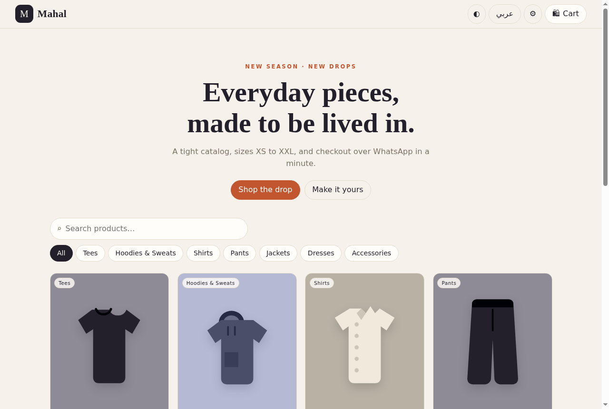
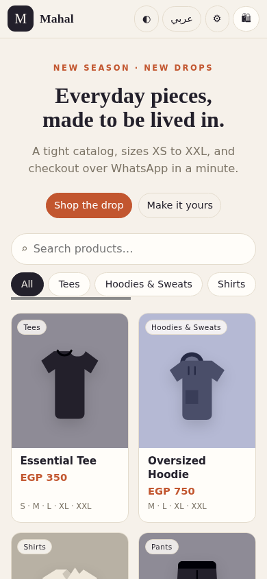
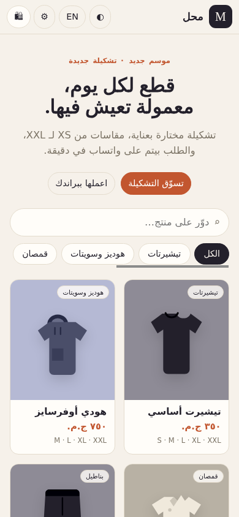
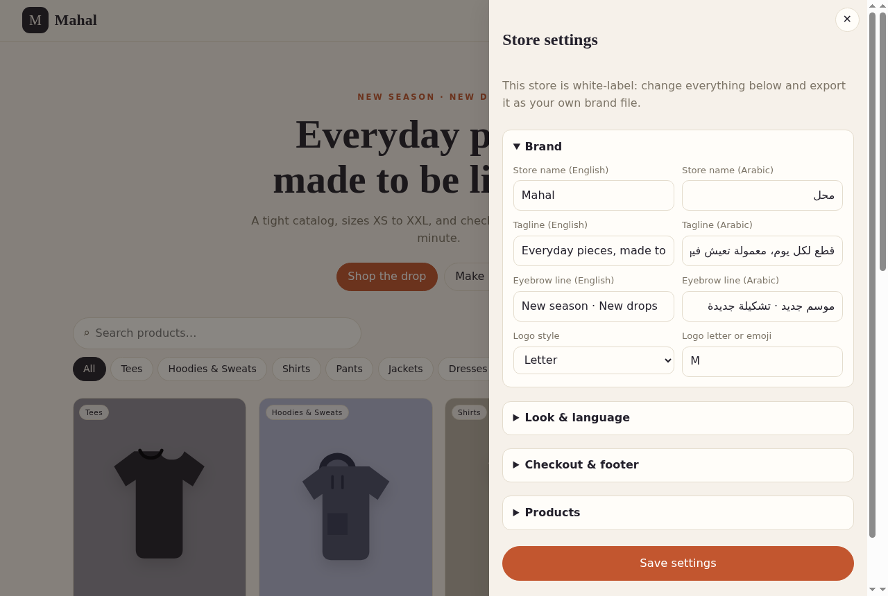
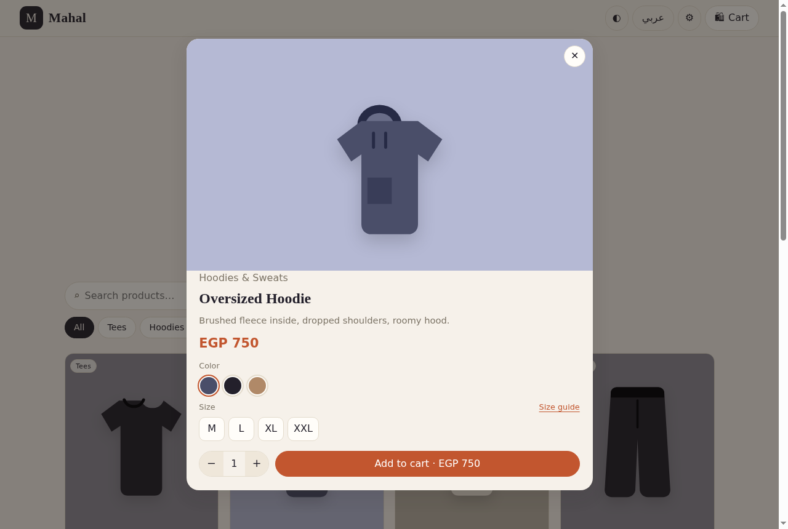
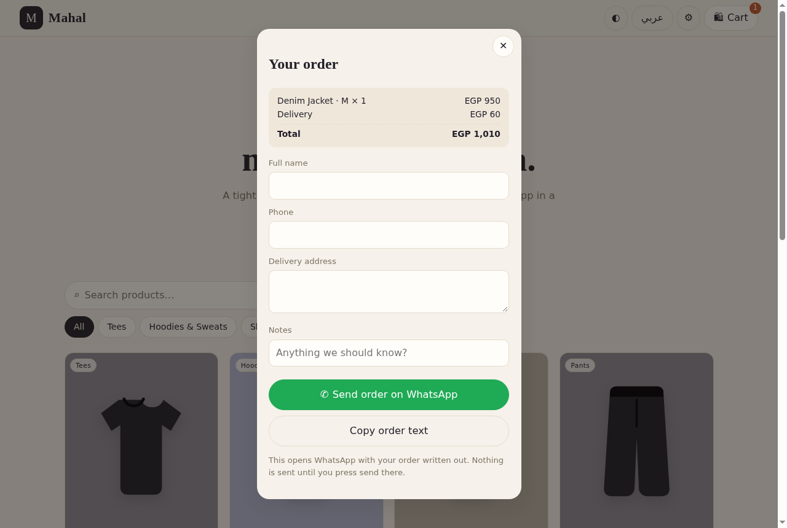

<div align="center">


# Mahal · محل

**A free white-label storefront for clothing brands. Catalog, sizes, cart, and checkout over WhatsApp, all rebrandable from one settings screen.**

[**Live demo**](https://yousefkhames.github.io/mahal/) · English and Arabic · Works offline · No sign-up



</div>

## What it is
Mahal is a complete clothing store that runs as a static page. A shop owner gets a catalog with sizes and color options, a persistent cart, and a checkout that hands the finished order to the shop's WhatsApp number as a ready-to-send message. There is no server, no database and no account.

It is built to be resold: open the settings screen, type the client's store name, pick their colors, upload their logo, set their currency and WhatsApp number, edit the catalog, then export one JSON brand file. Import that file on any other device and the same codebase is now their store.

## Features
- 12-product demo catalog with 10 hand-drawn garment shapes, recolored per product
- Product page with color swatches, size picker, quantity and a size guide
- Persistent cart (localStorage) with quantity editing, subtotal, delivery fee and total
- WhatsApp checkout: name, phone, address and notes become a prefilled order message to the shop's number, with a copy-to-clipboard fallback
- White-label settings: store name and tagline in English and Arabic, letter / emoji / uploaded-image logo, ink and accent colors, currency (EGP, USD, EUR, GBP, SAR, AED, KWD), default language, WhatsApp number, delivery fee, footer note
- Catalog manager: add, edit and delete products (name, price, category, artwork shape, sizes, colors, description) without touching code
- Export / import the whole brand (settings + catalog) as one JSON file
- Full English and Arabic (RTL) interface, switchable any time
- Mobile first, light and dark theme, works offline (PWA)
- Automated click-through test suite in `tests/`

| Storefront (mobile) | Arabic (RTL) | Settings |
|---|---|---|
|  |  |  |

| Product page | Cart and checkout |
|---|---|
|  |  |

## Tech stack
Plain HTML, CSS and JavaScript. No framework, no build step, no dependencies, no tracking. Garment artwork is inline SVG recolored at runtime. Hosted on GitHub Pages.

## Run it
```bash
git clone https://github.com/yousefkhames/mahal.git
cd mahal
python3 -m http.server   # open http://localhost:8000
```
Run the tests: serve the folder and open `tests/index.html`. The page title shows PASS or FAIL.

## Sell it to a shop
1. Open the live demo, press ⚙ Settings.
2. Fill in the shop's branding, WhatsApp number, currency and catalog.
3. Press **Export brand file** and keep the JSON.
4. Host this repo anywhere static. On the shop's device, open Settings → **Import brand file** and pick the JSON. Done.

## Honest limits
- Static site: cart, branding and catalog edits live in the browser's localStorage on each device. There is no shared inventory, no order history on a server, and no payment processing; orders arrive as WhatsApp messages and payment is arranged between buyer and shop (for example cash on delivery).
- Anyone using the device can open Settings and change the store; there is no admin login. On a shared device, export your brand file first.
- The demo WhatsApp number (`201000000000`) is a placeholder. Until the owner sets a real number in Settings, checkout refuses to send and tells the customer the shop has not set its number (so no order goes to a dead number).
- Arabic copy is written in Egyptian-friendly Arabic and has not had a professional review yet.

## License
MIT

## Fonts and limits (round 2)

- Cairo (SIL OFL) is bundled in `fonts/` (woff2) and precached by the service worker, so Arabic renders the same offline.

## Round 2 review notes
- Stored and imported data is sanitised before it is rendered (names, colours, logo, numbers); a brand import now asks for confirmation.
- Local numbers like 010... are converted to wa.me/2010...; Arabic digits work in the WhatsApp and fee fields.
- Copy order falls back to a hidden textarea and says so honestly if copying fails.
- Test: `python3 -m http.server 8750` then `node tests/e2e.cjs` (needs puppeteer-core).
- Limit: WhatsApp links are only verified as generated URLs.
